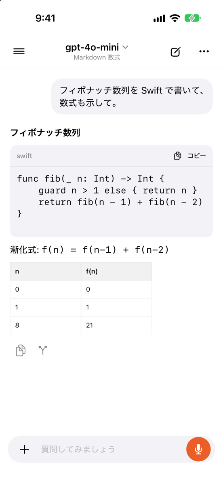
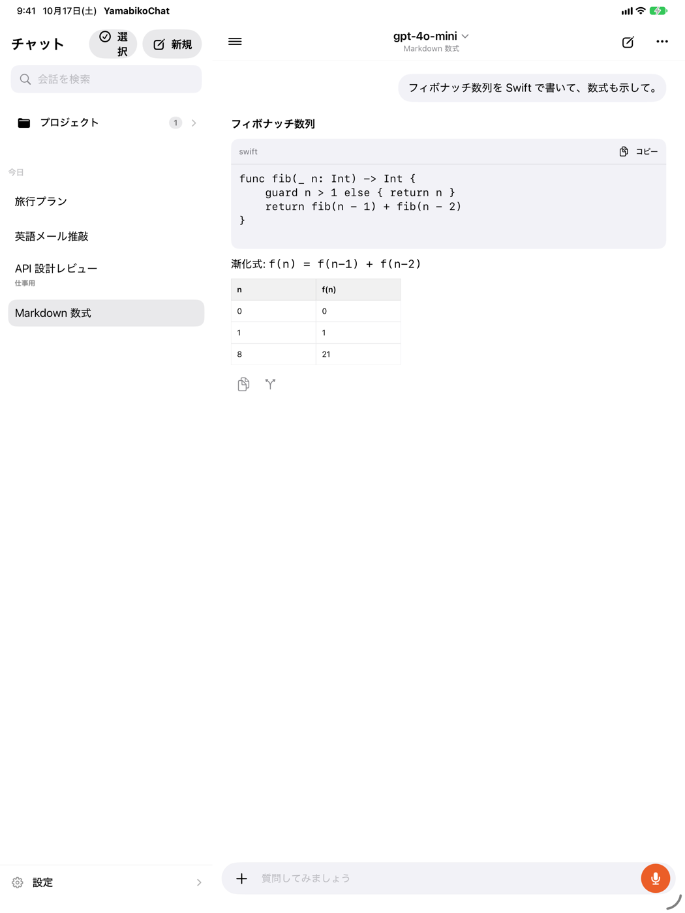

<div align="center">


# YamabikoChat

[English](README.md) · **日本語**

**iPhone・iPad で、AI と話す。回答を比べる。ツールで作業を進める。**

SwiftUI 製の AI チャットクライアント。
自分の API キーや対応アカウントで、複数のモデルをひとつのアプリから使えます。

<a href="https://apps.apple.com/jp/app/yamabikochat-ai%E3%83%81%E3%83%A3%E3%83%83%E3%83%88/id6771687018"></a>

[iPhone・iPad 用アプリを入手](https://apps.apple.com/jp/app/yamabikochat-ai%E3%83%81%E3%83%A3%E3%83%83%E3%83%88/id6771687018) · [スクリーンショット](#スクリーンショット) · [ソースからビルド](#開発環境とセットアップ) · [MIT License](LICENSE)

</div>

## スクリーンショット

日本語 UI とデモ会話を使った画面です。現在の App Store 配信版と表示が異なる場合があります。

| チャット・コード・数式 | インタラクティブな GenUI | ダークモード | 会話ライブラリ |
| :---: | :---: | :---: | :---: |
|  |  |  |  |

### iPad の分割表示



## できること

| 機能 | 内容 |
| --- | --- |
| チャット | ストリーミング応答、メッセージ編集、再生成、回答バリアントに対応。 |
| デュアル | 同じプロンプトを 2 つのモデルに送り、回答を並べて比較。 |
| 自動会話 | モデル・話題・ターン数を指定し、モデル同士の会話を進行。 |
| ツールとサブエージェント | Web 検索、Python、ファイル編集、ユーザーへの質問、作業の分担。 |
| リッチな回答表示 | Markdown、表、コード、数式、Mermaid、SVG、GenUI によるインタラクティブな UI。 |
| 会話の整理 | プロジェクト、履歴検索、モデルプリセット、トークン使用量の確認。 |
| iOS との連携 | Siri・ショートカット、Spotlight、共有拡張、画像・ファイル添付。 |
| iPad と多言語 | 分割表示、ダークモード、日本語・英語・简体中文・スペイン語・フランス語。 |

## アプリを使う

1. [App Store から YamabikoChat をインストール](https://apps.apple.com/jp/app/yamabikochat-ai%E3%83%81%E3%83%A3%E3%83%83%E3%83%88/id6771687018)します。
2. 設定でプロバイダーを選び、自分の API キーを登録するか、対応アカウントでサインインします。
3. モデルを選んで会話を開始します。用途に応じてデュアル・自動会話やツールを設定できます。

接続先には Google Gemini、OpenRouter、ChatGPT plan、xAI、Apple Intelligence、Sarashina、PLaMo、カスタムエンドポイントを用意しています。models.dev カタログから追加のプロバイダー・モデルも参照できます。利用できる機能やモデルは、プロバイダーの契約、認証方法、端末・OS、Pi ランタイムの対応状況によって異なります。プロバイダーの利用料金は各サービスの条件に従います。

App Store 版の利用に Xcode やソースのセットアップは不要です。このリポジトリは開発・検証用の公開ソースで、ストア配信版と更新時期が異なる場合があります。

## データと実行の仕組み

会話・設定は端末内に保存し、API キーと認証トークンは iOS Keychain で管理します。AI へのリクエストは選択したプロバイダーへ送信します。検索やリモートツールを有効にすると、そのツールの接続先にも必要な情報が送信されます。

AI 実行、プロバイダー認証、使用量、コンテキスト管理は内蔵の **Pi Agents** ランタイムを通します。未対応のモデルは理由を表示し、別のモデルや通信方式へ自動で置き換えません。Python は WebKit Worker 内の Pyodide で実行します。

- [プライバシーポリシー](ios/PRIVACY.md)・[利用条件](ios/TERMS.md)
- [認証情報と会話の境界](ios/PiRuntime/SECURITY.md)
- [Python の隔離設計](ios/docs/python-security.md)

## リポジトリ構成

| パス | 内容 |
| --- | --- |
| `ios/YamabikoChat/` | SwiftUI アプリ本体、データ管理、ネイティブツール。 |
| `ios/YamabikoShareExtension/` | 他のアプリからテキストや URL を受け取る共有拡張。 |
| `ios/PiRuntime/` | Pi Agents ランタイム、プロバイダー連携、JavaScript テスト。 |
| `ios/GenUIAssets/` | GenUI ウィジェット・トークン・アイコンの正本。 |
| `ios/YamabikoTests/`・`ios/YamabikoUITests/` | Swift の単体・UI テスト。 |
| `ios/GenUIRuntimeTests/`・`ios/PythonTests/` | DOM・Python ランタイムのテスト。 |
| `ios/scripts/`・`scripts/` | ビルド補助、上流契約・公開内容のチェック。 |
| `third_party/` | 依存ソフトウェアのライセンス。 |

公開対象はアプリ・共有拡張・ランタイムのソース、生成済み UI 資産、テスト、ビルド補助です。個人メモ、開発レビュー記録、App Store 提出資料、会話データ、認証情報、署名設定は含めません。著作権表示と依存元の出典は保持しています。

## 自分の設定でビルド・再配布する

Bundle ID と App Group は `org.example.yamabikochat` 系の開発用値です。実機配布では `ios/project.yml`、両ターゲットの entitlements、`AppConstants.swift`、Info.plist の識別子を自分のものに揃え、Xcode で自分の開発チームを指定してください。

アプリ内のサポートと案内先はこの公開リポジトリに設定しています。再配布する場合は自分の案内先・プライバシーポリシー・利用条件に更新してください。

## 開発環境とセットアップ

macOS、Xcode 27.1、XcodeGen、Node.js 24、Python 3 を使用します。Xcode 構成の正本は `ios/project.yml` です。

**現在の制約:** NodeMobile の検証済み配布マニフェスト `ios/node-mobile-release.json` は元ソースにも含まれていません。このためクリーン環境で `bootstrap.sh` はそのままでは完了しません。取得先やチェックサムを推測したファイルは同梱していません。

先に NodeMobile 配布元の検証済みリリースから次のフィールドを持つマニフェストを用意してください。`nodeVersion` は Node.js 24 のバージョン、`archiveURL` は `bootstrap-node-mobile.sh` が許可する配布元のリリースアーカイブ URL、`archiveSHA256` はその SHA-256 です。アーカイブには実機・シミュレーターの arm64 XCFramework と `third_party/nodejs-mobile/LICENSE` に一致するライセンスが必要です。第三者の別ランタイムへの自動置換は行いません。

```sh
cd ios
./bootstrap.sh
open YamabikoChat.xcodeproj
```

Python は WebKit Worker 内の Pyodide を使用します。bootstrap が固定済みの配布物を検証して取得します。詳しくは [Python の隔離設計](ios/docs/python-security.md) を参照してください。

GenUI の正本は `ios/GenUIAssets/` です。変更時は次のコマンドでアプリ内の生成物も更新します。

```sh
cd ios/GenUIAssets
npm install --ignore-scripts
python3 build.py
```

## 検証

```sh
python3 scripts/check-public-content.py
npm ci --prefix ios/PiRuntime
npm test --prefix ios/PiRuntime
npm ci --prefix ios/GenUIRuntimeTests --ignore-scripts
npm test --prefix ios/GenUIRuntimeTests
python3 -m unittest ios/PythonTests/test_yamabiko_runtime.py
npm run check:contracts --prefix ios/PiRuntime
```

上流契約の検証はネットワーク接続が必要です。iOS テストは bootstrap 完了後に実行します。

```sh
cd ios
xcodebuild -project YamabikoChat.xcodeproj -scheme YamabikoChat \
  -destination 'platform=iOS Simulator,name=iPhone 18 Pro,OS=27.0' \
  CODE_SIGNING_ALLOWED=NO test
```

## ライセンス

オリジナルコードは [MIT License](LICENSE) です。依存ソフトウェアの条件は [THIRD_PARTY_NOTICES.md](THIRD_PARTY_NOTICES.md) と `third_party/` を参照してください。
